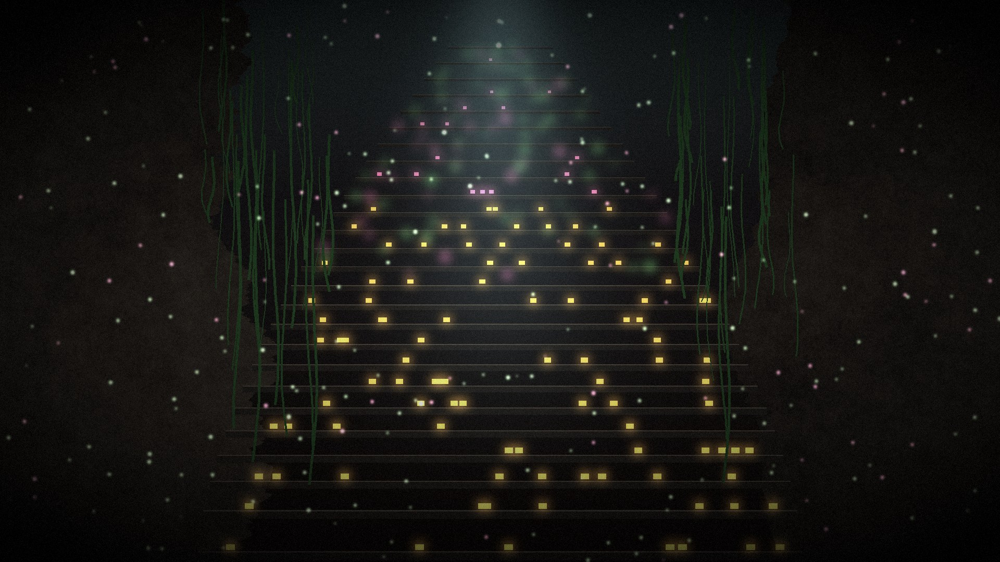

# 지하 100층

눈을 떠보니 가장 깊은 곳, B100 이었다. 위로 가는 계단만 열려 있었다.

열다섯 살 소년이 자신을 가둔 "납치범"을 찾아 지상으로 올라가는 3D 생존 · 도시 건설 게임입니다. 브라우저에서 바로 실행되며, 휴대폰과 PC 모두에서 플레이할 수 있습니다.



## 휴대폰으로 GitHub 에 올리기

모든 파일이 폴더 없이 한곳에 있어서 휴대폰에서도 한 번에 올릴 수 있습니다.

1. 휴대폰 파일 앱에서 zip 을 눌러 압축을 풉니다.
2. GitHub 에서 새 저장소를 만들고 **Add file → Upload files** 를 누릅니다.
3. 파일 선택 화면에서 압축을 푼 폴더로 들어가 **전체 선택**한 뒤 올리고 **Commit changes** 를 누릅니다.
4. 저장소 **Settings → Pages** 에서 Branch 를 `main`, 폴더를 `/ (root)` 로 지정하고 저장합니다.
5. 1~2분 뒤 `https://<아이디>.github.io/<저장소 이름>/` 에서 플레이할 수 있습니다.

저장소 첫 화면에 `index.html`, `main.js`, `style.css`, `three.module.js` 와 `tex_`, `img_`, `bgm_`, `sfx_` 로 시작하는 파일들이 나란히 보이면 제대로 올라간 것입니다.

## PC 에서 실행하기

`index.html` 을 더블클릭하면 브라우저 보안 때문에 동작하지 않습니다. 폴더에서 로컬 서버를 띄우세요.

```bash
python -m http.server 8000
```

그다음 `http://localhost:8000` 을 엽니다.

## 조작법

**휴대폰 (가로 화면)**

| 버튼 | 동작 |
|---|---|
| 왼쪽 화면 | 손가락을 대고 끌면 이동, 끝까지 밀면 달리기 |
| 공격 | 누르고 있으면 계속 휘두른다 |
| 던지기 | 가장 가까운 적을 자동으로 노린다. 공중의 적은 이걸로 |
| 구르기 | 잠깐 무적 |
| 상호작용 | 계단 · 문 · 단말기 · 녹음기 · 생존자. 빛나면 누를 수 있다 |
| 회복 | 붕대 · 통조림 사용 |
| 위쪽 버튼 | 무기 교체 · 가방 · 스탯 · 기록 · 도시 · 메뉴 |

게임을 시작하면 전체 화면과 가로 모드로 바뀝니다 (아이폰은 직접 가로로 돌려주세요).

**키보드와 마우스**

| 키 | 동작 |
|---|---|
| WASD | 이동 |
| 마우스 | 조준 |
| 좌클릭 | 근접 공격 |
| 우클릭 | 던지기 · 쏘기 (공중의 적은 이걸로) |
| Shift | 달리기 (스태미나 소모) |
| Space | 구르기 (잠깐 무적) |
| E | 계단 · 문 · 단말기 · 녹음기 · 생존자 |
| F | 회복 아이템 사용 |
| Q / R | 근접 / 원거리 무기 바꾸기 |
| I | 가방 · 제작 |
| K | 스탯 |
| J | 녹음 · 가족사진 |
| T | 도시 관리 (B68 이후) |
| Esc | 메뉴 · 저장하고 타이틀로 |

## 게임 구조

- **B100 ~ B69** 혼자 버티는 생존 구간
- **B68 ~ B2** 주민들과 함께하는 도시 건설 구간 (처음 5명, 최대 20명)
- **B1** 무너진 통제실

| 시스템 | 내용 |
|---|---|
| 감염 단계 | 새싹 → 덩굴 → 개화 → 군락 → 숙주 → 완전 잠식. 몬스터 능력치 = 기본치 × (1 + (100 − 층) × 0.05) |
| 중간 보스 | 5층마다 19종. 공중 보스(덩굴박쥐 군주, 나방 여왕, 여왕벌, 나비 떼, 까마귀 왕, 군락 여왕벌, 독화 나비 여왕)는 원거리 무기가 필요 |
| 감염된 방 | 3층마다. 입장료를 내고 들어가면 문이 잠기고, 웨이브를 버틴 뒤 포자 심장을 부숴야 나올 수 있다. 시간이 지나면 차오르고 100% 가 되면 40% 가 층으로 쏟아진 뒤 60% 로 내려간다. 방 안에서 죽으면 잃는 것이 없다 |
| 보스 · 방 겹침 층 | B85, B70, B55, B40, B25, B10 은 감염된 방 대신 보스 처치 후 잔몹이 몰려나온다 |
| 재감염 | 이미 정화한 층으로 내려가면 7.5% 확률로 다시 감염 |
| 사망 | 일반 층에서는 돈과 아이템 50% 를 잃고 그 층에서 부활 |
| 레벨 스탯 | 최대 레벨 80, 레벨마다 2포인트 (힘 · 체력 · 투척 · 기본 속도 · 스태미나) |
| 층 스탯 | 한 층 오를 때마다 생존력(회피) · 손기술(제작) · 멘탈 +1 |
| 포기 | 한 층 오를 때마다 판정. 0.01% ~ 1%, 높은 층에서 멘탈이 낮을수록 위험. 돈과 재료를 잃는다 |
| 무기 | 근접 21종, 원거리 13종. 던진 물건은 주워 올 수 있고, 총은 탄약을 사야 한다 |
| 주민 | 주민마다 할 수 있는 일이 두 가지, 그중 하나만 맡길 수 있다. 의사 · 대장장이 · 연구원은 드물다 |

모든 수치는 `data.js` 에 모여 있습니다. 전체 난이도는 맨 위의 `BALANCE` 값으로 조절할 수 있습니다.

## 파일 구성

휴대폰에서도 올릴 수 있도록 폴더를 쓰지 않고, 파일 이름 앞부분으로 종류를 나눴습니다.

| 파일 | 내용 |
|---|---|
| `index.html`, `style.css` | 진입점과 화면 디자인 |
| `main.js` | 타이틀 · 로딩 · 렌더 루프 |
| `game.js` | 게임 본체 (층 이동, 감염된 방, 보스, 도시, 저장) |
| `data.js` | 몬스터 · 보스 · 무기 · 제작 · 상점 · 주민 수치 |
| `story.js` | 대사, 녹음, 엔딩 |
| `world.js` | 층 생성과 충돌 |
| `enemies.js` | 몬스터 AI 와 보스 패턴 |
| `player.js` | 주인공 조작과 전투 |
| `touch.js` | 휴대폰 터치 조작 |
| `models.js` | 3D 모델 (기본 도형 조립) |
| `ui.js` | HUD, 미니맵, 패널, 대화창, 엔딩 연출 |
| `state.js` | 저장 데이터와 스탯 계산 |
| `audio.js` | BGM · 효과음 재생 |
| `three.module.js` | three.js r160 (MIT, `three-LICENSE.txt`) |
| `tex_*.png` | 바닥 · 벽 · 철판 텍스처와 노멀맵 |
| `img_*.jpg` | 타이틀, 가족사진 2장, 엔딩 그림 2장 |
| `bgm_*.mp3` | 7곡 (타이틀, 탐험, 주민 구간, 감염된 방, 보스, 아버지, 엔딩) |
| `sfx_*.mp3` | 효과음 22개 |
| `gen_images.py`, `gen_audio.py` | 그림과 소리를 다시 만드는 스크립트 |

## 에셋 다시 만들기

그림과 소리는 모두 `gen_images.py`, `gen_audio.py` 가 직접 그리고 합성한 오리지널입니다. 바꾸고 싶으면 스크립트를 고친 뒤 다시 실행하세요.

```bash
pip install numpy scipy pillow
python gen_images.py
python gen_audio.py        # ffmpeg 필요
```

다른 그림이나 음악으로 바꾸려면 같은 이름의 파일로 교체하면 됩니다.

## 개발자 모드

주소 끝에 `?dev=1` 을 붙이면 테스트용 키가 켜집니다.

| 키 | 동작 |
|---|---|
| F1 | 판정 없이 한 층 올라가기 |
| F2 | 돈 5000, 모든 재료 5개 |
| F3 | 레벨 업 |
| F4 | 무적 켜기 · 끄기 |
| F6 | 10층 건너뛰기 |
| F7 | 이 층의 감염된 방을 넘치기 직전으로 |

## 알려진 한계

- 휴대폰은 가로 화면에서만 플레이할 수 있습니다. 오래된 휴대폰에서는 화면이 버벅일 수 있습니다.
- 저장은 브라우저의 localStorage 에 됩니다. 다른 브라우저나 기기로는 이어지지 않습니다.
- 글꼴(IBM Plex Sans KR, Gowun Batang)은 Google Fonts 에서 불러오므로 오프라인에서는 기본 글꼴로 보입니다.
